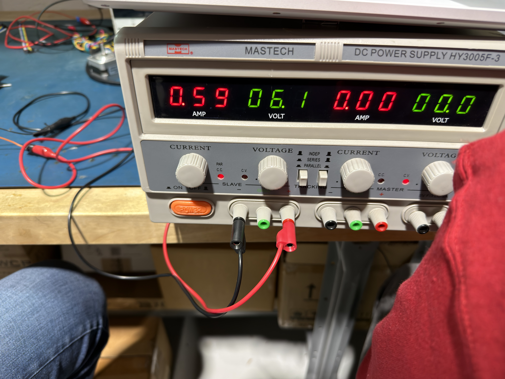
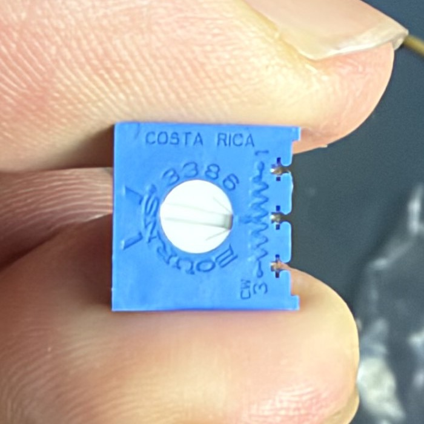
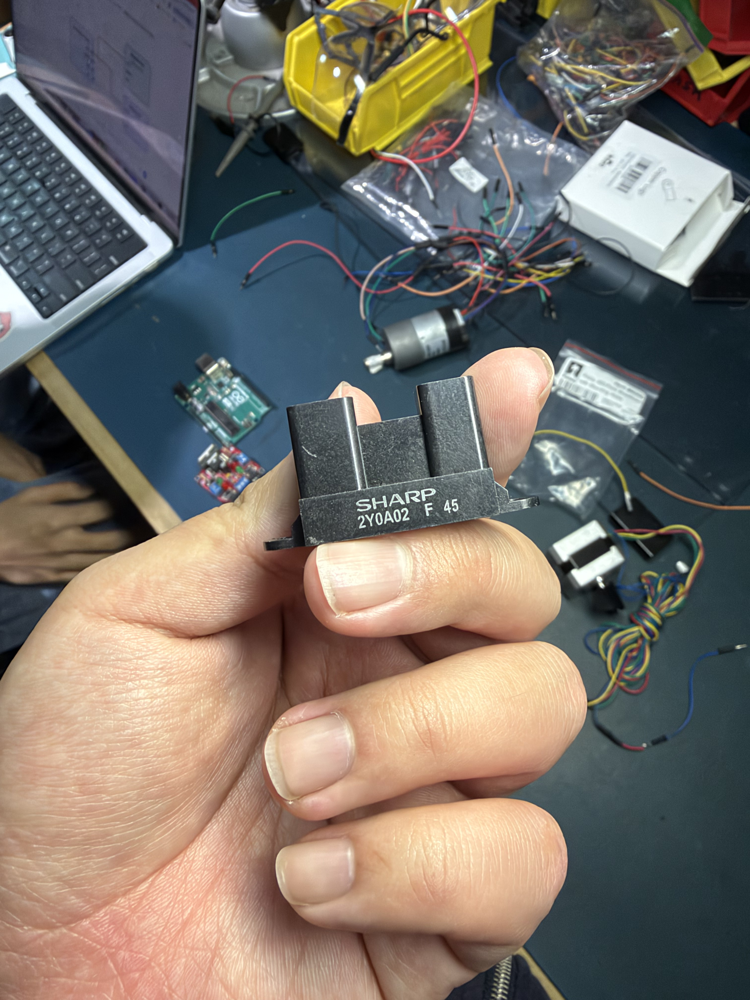
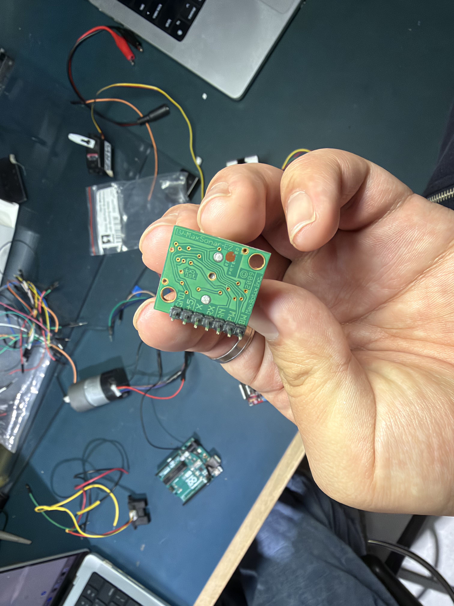
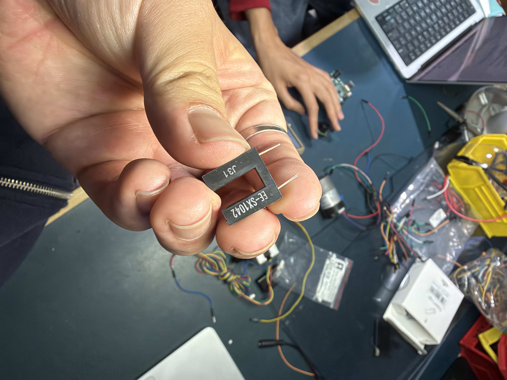
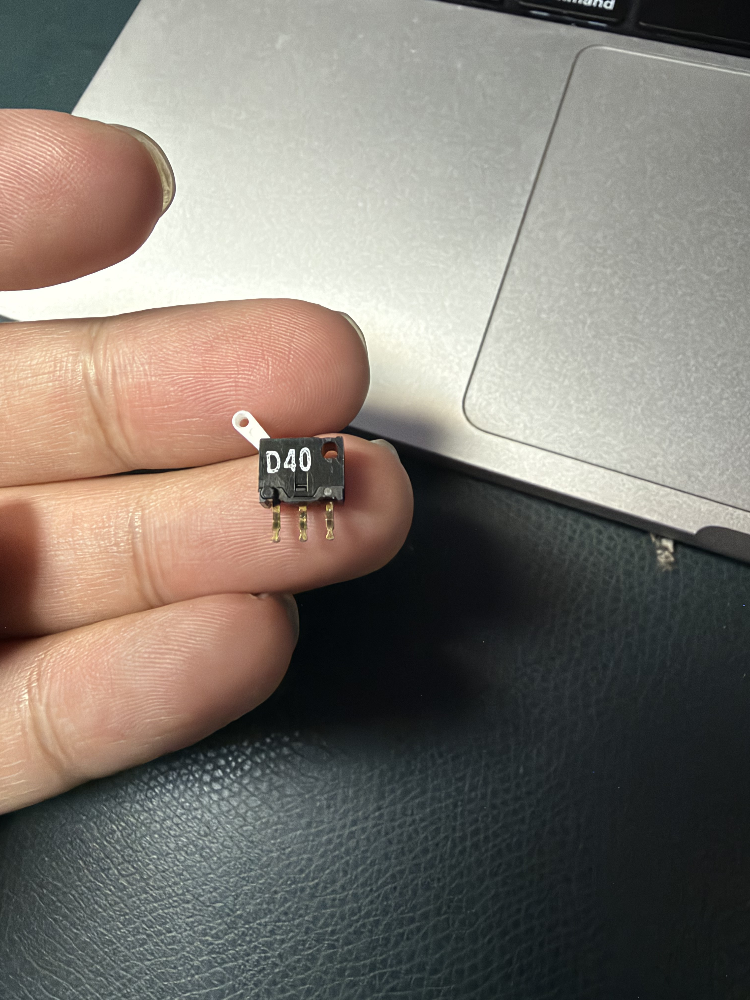
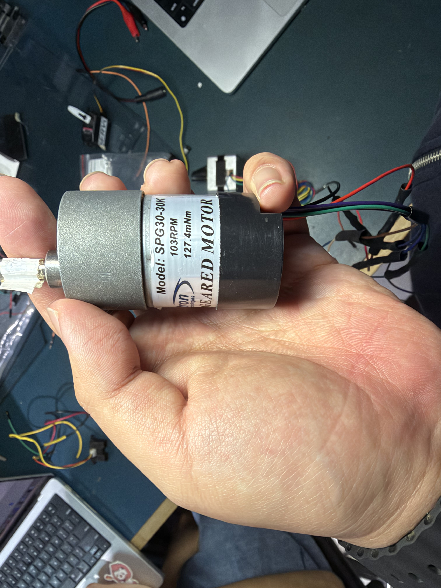
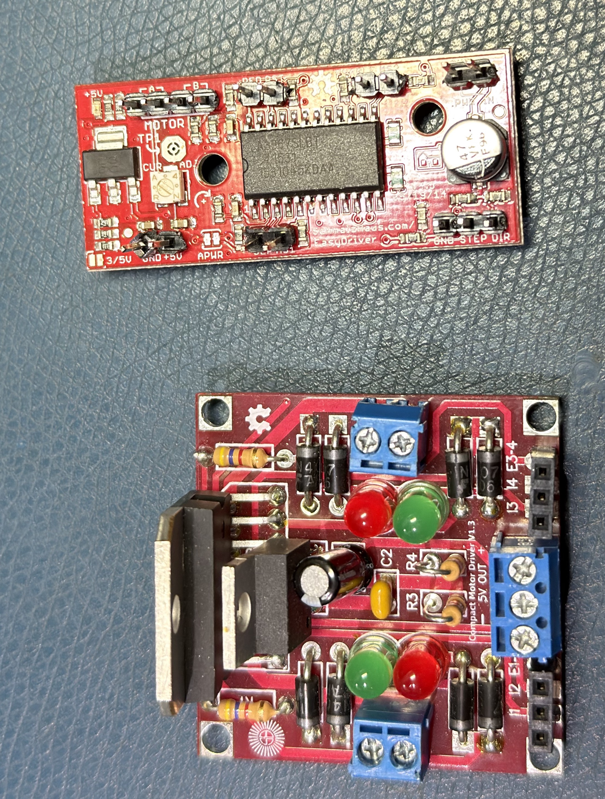
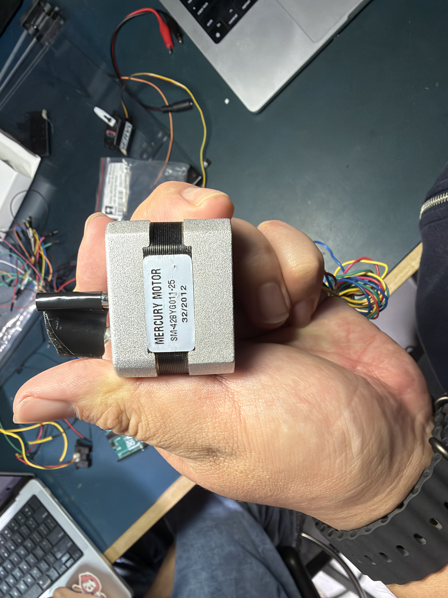
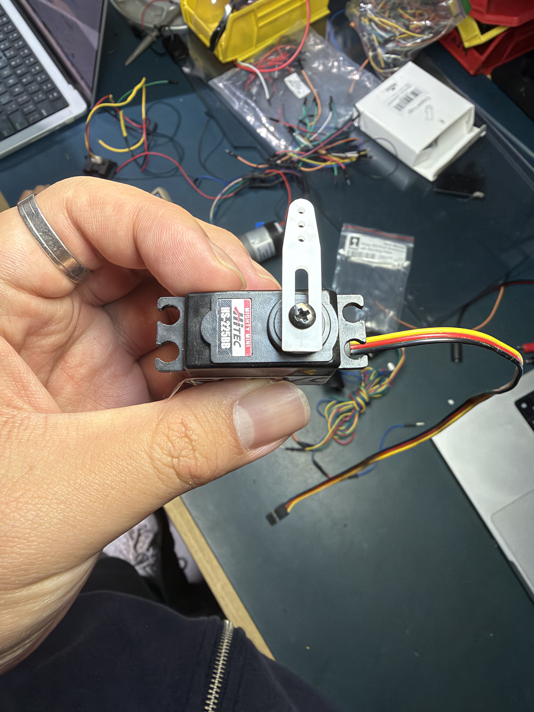

# Sensor and Motor Wiring

## 1. Component List

| ID | Component / Model | Qty | Photo |
|---|---|---:|---|
| U1 | Arduino Uno | 1 | |
| BB1 | Breadboard | 1 | |
| PS1 | MASTECH HY3005F-3 bench power supply | 1 |  |
| S1 | Bourns 3386 trimmer potentiometer | 1 |  |
| S2 | Sharp GP2Y0A02YK0F IR distance sensor | 1 |  |
| S3 | MaxBotix LV-MaxSonar-EZ0 / Pololu 723 ultrasonic sensor | 1 |  |
| S4 | Omron EE-SX1042 slot sensor | 1 |  |
| SW1 | Three-terminal lever microswitch, marked D40 | 1 |  |
| Motor A | Cytron SPG30-30K DC gearmotor | 1 |  |
| Driver A | Solarbotics L298 Compact Motor Driver | 1 | <br>Bottom board |
| Motor B | Mercury Motor SM-42BYG011-25 stepper motor | 1 |  |
| Driver B | EasyDriver v4.4 | 1 | <br>Top board |
| Motor C | Hitec HS-225BB / MIGHTY MINI servo | 1 |  |
| R1 | 220 Ω resistor | 1 | |
| R2 | 1 kΩ resistor | 1 | |
| R3 | 4.7 kΩ resistor | 1 | |
| — | USB data cable | 1 | |
| — | Jumper wires and power leads | As required | |

External capacitors: none.

## 2. Power Supply Settings

| Supply | Voltage | Connect to |
|---|---|---|
| Bench supply, adjustable output | 12V | Solarbotics power `+`; EasyDriver `M+` |
| Bench supply, fixed output | 5V | Servo red wire |
| Arduino `5V` | 5V | S1 pin 3; S2 Vcc; S3 +5; Motor A HALL VCC; R1 |

**Common GND:** both bench supply negative terminals, Arduino GND, breadboard GND, all sensor and driver grounds, encoder HALL GND, and servo black wire.

## 3. Sensors and Switch

### S1 — Bourns 3386 Potentiometer (3 Pins)

| Pin | Connect to |
|---|---|
| 1 | GND |
| 2 — Wiper | Arduino A0 |
| 3 | Arduino 5V |

### S2 — Sharp GP2Y0A02YK0F (3 Pins)

| Pin / Wire colour | Connect to |
|---|---|
| 1 — Vo, yellow | Arduino A1 |
| 2 — GND, black | GND |
| 3 — Vcc, red | Arduino 5V |

### S3 — MaxBotix LV-MaxSonar-EZ0 (7 Pins)

| Pin | Connect to |
|---|---|
| +5 | Arduino 5V |
| GND | GND |
| AN | Arduino A2 |
| BW | Unconnected |
| PW | Unconnected |
| RX | Unconnected |
| TX | Unconnected |

### S4 — Omron EE-SX1042 (4 Pins)

| Pin | Connect to |
|---|---|
| A — LED anode | Arduino 5V through R1 (220 Ω) |
| K — LED cathode | GND |
| C — Collector | Arduino A3 |
| E — Emitter | GND |

### SW1 — Three-Terminal Microswitch

| Terminal | Connect to |
|---|---|
| COM | GND |
| NO | Arduino A4 |
| NC | Unconnected |

## 4. Motor A — DC Motor and Solarbotics Driver

### Cytron SPG30-30K (6 Contacts)

| Contact | Label | Connect to |
|---|---|---|
| 1 | MOTOR− | One terminal of Solarbotics channel 1 motor output |
| 2 | MOTOR+ | The other terminal of the same output |
| 3 | HALL VCC | Arduino 5V |
| 4 | HALL GND | GND |
| 5 | Ch A | Arduino D2 |
| 6 | Ch B | Arduino D3 |

### Solarbotics L298 Compact Motor Driver

| Terminal | Connect to |
|---|---|
| Power `+` | Bench 12V + |
| Power `−` | GND |
| `5V OUT` | Unconnected |
| `I1` | Arduino D4 |
| `I2` | Arduino D7 |
| `E1-2` | Arduino D5; R3 (4.7 kΩ) to GND |
| `I3` | GND |
| `I4` | GND |
| `E3-4` | GND |
| Channel 1 motor output, 2 terminals | Motor A contacts 1 and 2 |
| Channel 2 motor output, 2 terminals | Unconnected |

## 5. Motor B — Stepper Motor and EasyDriver

### Mercury Motor SM-42BYG011-25 (4 Wires)

| Motor wire | Connect to |
|---|---|
| Coil A, first wire | One terminal of EasyDriver output `A` |
| Coil A, second wire | The other terminal of EasyDriver output `A` |
| Coil B, first wire | One terminal of EasyDriver output `B` |
| Coil B, second wire | The other terminal of EasyDriver output `B` |

### EasyDriver v4.4

| Pin | Connect to |
|---|---|
| `M+` | Bench 12V + |
| `GND` | GND |
| `STEP` | Arduino D6 |
| `DIR` | Arduino D8 |
| `ENABLE` | Arduino D10; R2 (1 kΩ) to EasyDriver onboard +5V |
| `+5V` | R2 to ENABLE |
| `MS1` | GND |
| `MS2` | GND |
| `RST / RESET` | Unconnected |
| `SLP / SLEEP` | Unconnected |
| `PFD` | Unconnected |
| `A`, 2 outputs | Motor B coil A |
| `B`, 2 outputs | Motor B coil B |

## 6. Motor C — Hitec HS-225BB Servo (3 Wires)

| Wire colour | Connect to |
|---|---|
| Yellow | Arduino D9 |
| Red | Bench fixed 5V + |
| Black | GND |

## 7. Resistor Connections

### R1 — 220 Ω

```text
Arduino 5V ── [220 Ω] ── EE-SX1042 A
```

### R2 — 1 kΩ

```text
Arduino D10 ──────────── ● ── EasyDriver ENABLE
                        │
                     [1 kΩ]
                        │
                 EasyDriver onboard +5V
```

### R3 — 4.7 kΩ

```text
Arduino D5 ───────────── ● ── Solarbotics E1-2
                        │
                    [4.7 kΩ]
                        │
                       GND
```

## 8. Arduino Uno Connection Summary

| Arduino interface | Connect to |
|---|---|
| USB | Computer |
| 5V | Breadboard 5V rail |
| GND | GND |
| A0 | Potentiometer pin 2 |
| A1 | Sharp Vo |
| A2 | MaxSonar AN |
| A3 | EE-SX1042 C |
| A4 | Switch NO |
| D2 | Motor A encoder Ch A, contact 5 |
| D3 | Motor A encoder Ch B, contact 6 |
| D4 | Solarbotics I1 |
| D5 | Solarbotics E1-2; R3 to GND |
| D6 | EasyDriver STEP |
| D7 | Solarbotics I2 |
| D8 | EasyDriver DIR |
| D9 | Servo yellow wire |
| D10 | EasyDriver ENABLE; R2 to EasyDriver onboard +5V |
| D0, D1, D11, D12, D13, A5 | Unconnected |
| 3.3V, VIN, AREF, RESET, IOREF, ICSP, barrel power jack | Unconnected |
