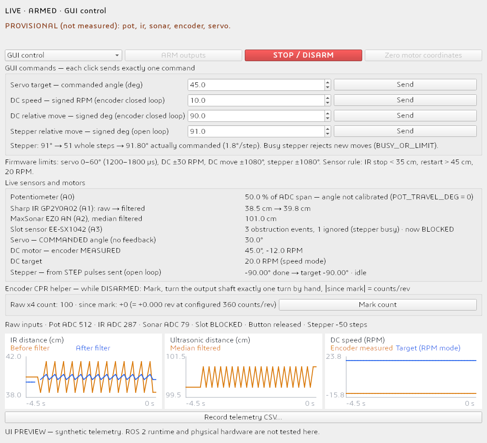

# ROS 2 Serial Bridge and rqt Control Panel

`sensor_motor_lab` has two parts:

- **`lab_bridge` node**: talks to the Uno over USB serial, publishes state, and subscribes to commands. Motor closed loops run on the Uno; the bridge only forwards.
- **rqt plugin `Sensors and Motor Control`**: graphical controls, live plots, and CSV logging.

## Environment (pick one)

**A. conda (Windows / Linux / macOS; RoboStack provides ROS 2 Humble)**

```bash
conda env create -f environment.yml        # from the project root
conda activate sensorMotorLab
# On Windows, compiling the C++ tests also needs: conda install -n sensorMotorLab -c conda-forge gxx_win-64
# On Linux, compiling the C++ tests also needs:   conda install -n sensorMotorLab -c conda-forge cxx-compiler
```

**B. Native apt install of ROS 2 Humble on Ubuntu 22.04**

```bash
sudo apt install python3-colcon-common-extensions python3-serial \
  ros-humble-rqt ros-humble-rqt-gui-py ros-humble-python-qt-binding
source /opt/ros/humble/setup.bash
```

Both options were actually built and run successfully on 2026-11-09; see [../tests/TEST_REPORT.md](../tests/TEST_REPORT.md).

## Build

```bash
cd ros2_ws
colcon build --merge-install        # Windows (no symlink permission needed)
colcon build --symlink-install      # Linux / macOS
```

Load the environment: Windows `call install\setup.bat` (PowerShell: `install\setup.ps1`); Linux `source install/setup.bash`.

## Run

First **close the Arduino Serial Monitor** (a serial port can only be opened by one program at a time).

```bash
ros2 launch sensor_motor_lab lab.launch.py port:=COM5            # Windows
ros2 launch sensor_motor_lab lab.launch.py port:=/dev/ttyACM0    # Linux (permission issues: add your user to the dialout group and log in again)
ros2 launch sensor_motor_lab lab.launch.py gui:=false            # bridge only
```

Starting the parts separately:

```bash
ros2 run sensor_motor_lab lab_bridge --ros-args -p port:=COM5
rqt --standalone sensor_motor_lab.dashboard.LabDashboard
```

If rqt has cached an old plugin list: run `rqt --force-discover`, then choose **Robot Tools → Sensors and Motor Control**.

**WSL users**: by default WSL cannot see Windows COM ports. Install [usbipd-win](https://github.com/dorssel/usbipd-win) to forward the Uno into WSL (`/dev/ttyACM0`). It is simpler to run directly in the Windows conda environment.

## Topics

| Topic | Type | Direction | Contents |
|---|---|---|---|
| `/lab/state` | String (JSON) | bridge → | All 21 STATE fields |
| `/lab/raw` | String (JSON) | bridge → | Raw ADC, button, `enc_counts`, `step_steps` |
| `/lab/config` | String (JSON), **TRANSIENT_LOCAL** | bridge → | Actual firmware limits and calibration status; late subscribers also receive it |
| `/lab/event` | String (JSON) | bridge → | ack, rejected, unconfirmed, connected/disconnected, controller_info, config… |
| `/lab/pot_deg` `/lab/pot_pct` `/lab/ir_raw_cm` `/lab/ir_cm` `/lab/sonar_cm` `/lab/dc_deg` `/lab/dc_rpm` `/lab/dc_target` `/lab/step_deg` `/lab/step_target_deg` | Float32 | bridge → | For plotting with rqt_plot and similar tools; negative values are invalid markers |
| `/lab/command` | String `{"verb":..,"value":..}` | → bridge | Commands |
| `/lab/operator_alive` | String `"alive"` | → bridge | GUI heartbeat every 0.5 s (operator lease) |

## Safety logic (bridge side)

- Sends STOP right after connecting and **never ARMs automatically**; reconnecting does not replay any motion command.
- Sequence numbers are derived from a timestamp: even if the Uno is not reset by DTR, restarting the bridge does not cause `STALE_SEQ`.
- Motion commands are rejected until the firmware CONFIG is received; after that, commands outside the firmware's actual limits are rejected locally and never sent to the Uno.
- If the ACK for a relative move is lost, it is **not resent**; the bridge only reports `unconfirmed` and prompts the operator to check the state before acting.
- Telemetry interrupted for 1.5 s → attempt STOP, close the serial port, reconnect after 2 s.
- GUI heartbeat stale for 1.5 s → send STOP; without a heartbeat, ARM and motion commands are rejected (STOP is always allowed).
- The firmware's own 1.5 s watchdog is the last line of protection (it stops even if ROS dies entirely).

## Using the GUI

1. Wait for the top bar to show `LIVE · DISARMED`. A yellow notice lists subsystems that are still PROVISIONAL; if it shows `ARM DISABLED`, `HARDWARE_CONFIG_VERIFIED` is still false.
2. Choose GUI or Sensor mode (the physical switch can also toggle it).
3. Press **ARM outputs**. In GUI mode each click of **Send** sends exactly one command; input ranges come from the firmware CONFIG.
4. Below the stepper input, the GUI shows live "rounded to N steps, actual X degrees".
5. **STOP / DISARM** is always available; **Zero motor coordinates** can only be used while DISARMED.
6. **Encoder CPR helper**: while DISARMED, press Mark, turn the output shaft one revolution by hand, and read `since mark`.
7. **Record telemetry CSV…**: only records rows whose STATE and RAW timestamps match exactly.

The display labels distinguish three sources: the servo shows the **commanded angle** (no feedback), the stepper shows a **value inferred from steps sent** (open loop), and DC shows the **encoder measurement**.



The image above is a preview rendered offscreen from synthetic telemetry, not a screenshot from the hardware.
